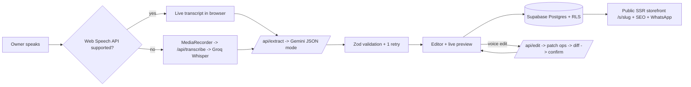

# VaaniStore — Voice-to-Storefront Builder

> **Bolo, aur dukaan online.** A kirana, boutique or mobile-shop owner taps a mic, describes their shop in English, Hindi or Hinglish, and gets a mobile-friendly shop page with products, hours, map and a WhatsApp order button. They can fix it later by voice too: _"Sunday ko bhi khula rakho 10 se 2"_.


<!-- TODO: record a 20-second screen capture of the dashboard flow and save it as docs/demo.gif -->

## The problem

India has over a crore small shops, and most have no web presence. Website builders assume a laptop, typing in English and time to learn a tool. Shop owners have a cheap Android phone, speak in Hindi or Hinglish, and already run their business on WhatsApp. VaaniStore meets them there: **speak for 30 seconds, get a page customers can order from on WhatsApp.**

## Features

- 🎤 **Voice input**: Web Speech API (free, live transcript) with a Groq Whisper fallback for browsers without it. Max 2 minutes / 10 MB.
- ✨ **AI extraction**: Gemini in JSON mode turns speech into a structured `ShopProfile`, validated with Zod, with one self-correcting retry. It never invents facts; missing fields are listed and asked for.
- 🗣️ **Voice edits**: "add Parle-G 10 rupees", "Maggi khatam ho gaya" → typed patch operations → before/after diff → Confirm or Discard → 10-step undo.
- 🏪 **Storefront**: light and dark themes, open-now badge (computed in IST), ₹ prices, per-product WhatsApp order links, Google Maps, call button, UPI ID copy.
- 🔐 **Auth and publishing**: Supabase magic link / Google login, Postgres with Row Level Security, product photos compressed to under 300 KB before upload, slug collision handling.
- 🔎 **SEO**: server-rendered and cached `/s/<slug>` with title, description, Open Graph and `LocalBusiness` JSON-LD.
- 📲 **PWA**: installable, offline shell, Hindi/English UI toggle, shareable link and printable QR code.
- 🛒 **Cart + one-tap order**: customers add items with quantities and send one WhatsApp message listing every line and the total, then optionally pay that amount through any UPI app (standard `upi://pay` link; they confirm with their own PIN).
- 📷 **Scan a price list**: the owner photographs a handwritten or printed rate list; Gemini vision reads items and prices (skipping dates, phone numbers and totals, never guessing unreadable prices); the owner ticks what to keep and existing products get their prices updated.
- 📈 **Owner insights**: anonymous visits, WhatsApp/call/directions taps, orders and most-ordered products for the last 7 days. Recorded only through a database function that checks the shop is published and caps each shop at 120 events/minute; no names, numbers, IPs or cookies.
- 📊 **Evaluation**: 30 labelled transcripts with per-field accuracy, field-level F1, hallucination count and latency.

## Architecture



| Path                                 | What it does                                                                           |
| ------------------------------------ | -------------------------------------------------------------------------------------- |
| `src/lib/schema.ts`                  | Zod schemas: the single source of truth for shop data                                  |
| `src/lib/prompts/`                   | Extraction and edit prompts (kept separate so they're easy to iterate on)              |
| `src/lib/ai/llm.ts`                  | Gemini call + `generateValidated` (parse → validate → retry once with the Zod error)   |
| `src/lib/extract.ts`                 | Model output → clean profile (we assign ids and slugs and compute `missing` ourselves) |
| `src/lib/patch.ts`                   | Voice-edit operations, pure `applyPatch`, `diffProfiles`                               |
| `src/lib/hours.ts`                   | Open-now logic in Asia/Kolkata (handles past-midnight and 24-hour shops)               |
| `src/components/StorefrontView.tsx`  | One component for both the live preview and the public page                            |
| `src/app/s/[slug]/page.tsx`          | Public page: cached read, metadata, JSON-LD                                            |
| `supabase/migrations/0001_shops.sql` | Table, RLS policies, slug check function, storage bucket                               |
| `eval/`                              | Labelled transcripts, scorer, runner                                                   |

## Key design decisions (interview notes)

- **Validate everything the model says.** The model gets a loose schema; our code then assigns product ids and slugs and computes the `missing` list itself. If validation fails, we retry once with the exact Zod error, and after a second failure the owner gets the manual form instead of a broken page.
- **Edits are operations, not a regenerated profile.** Asking the model to return the whole profile again risks silently dropping fields. Typed ops (`set_hours`, `remove_product` …) are validated individually, product ids are checked against the current profile, and the owner sees a diff before anything changes.
- **Never invent facts.** The prompt forbids guessing, and the eval counts hallucinations (fields filled in that were never said) as their own metric.
- **Open-now runs in the browser.** The public page is cached for hours, so a server-computed badge would go stale. The badge is computed client-side in IST.
- **RLS is the security boundary.** API routes act as the logged-in user; Postgres policies, not app code, stop one owner editing another's shop. A `security definer` function checks slug availability without exposing unpublished shops.
- **AI routes are rate-limited and budget-capped**: 10/minute and 100/day per IP, plus a global daily cap (`AI_DAILY_LIMIT`), stored in Upstash Redis so all serverless instances share the counts (in-memory fallback for dev). The limiter checks rules in order and stops at the first one exceeded, so a blocked bot doesn't eat the global budget.
- **Defence in depth on input**: Zod length/count caps on every field, a 64 KB body cap, same-origin checks on every write (CSRF), https-only image URLs, and a database `CHECK` on profile size.

## Setup

**Requirements:** Node 20+ (tested on 24), a free [Supabase](https://supabase.com) project, and API keys from [Google AI Studio](https://aistudio.google.com/apikey) (Gemini) and [Groq](https://console.groq.com/keys).

```bash
npm install
cp .env.example .env.local   # then fill in the values
npm run dev                  # http://localhost:3000
```

**Supabase:**

1. SQL Editor → run the files in `supabase/migrations/` in order (`0001` → `0004`).
2. Authentication → URL Configuration: set **Site URL** to your app URL, and add `http://localhost:3000/auth/callback` and `https://<your-app>/auth/callback` to **Redirect URLs**.
3. (Optional) Authentication → Providers → Google: add an OAuth client from Google Cloud Console.

`/preview` works with no keys at all, and so does the voice → transcript step in Chrome.

## Scripts

| Command                                 | Purpose                                                        |
| --------------------------------------- | -------------------------------------------------------------- |
| `npm run dev` / `build` / `start`       | Next.js                                                        |
| `npm run lint` / `typecheck` / `format` | Code quality                                                   |
| `npm test`                              | Vitest unit tests                                              |
| `npm run test:e2e`                      | Playwright end-to-end flow (AI endpoints stubbed)              |
| `npm run eval`                          | Extraction accuracy on 30 transcripts (needs `GEMINI_API_KEY`) |
| `npm run check`                         | Format + lint + typecheck + unit tests in one go               |
| `npm run check:env`                     | Fails if production environment variables are missing or wrong |

## Evaluation

`eval/transcripts.json` has 30 cases: 10 English, 10 Hindi (Devanagari) and 10 Hinglish, across kirana, medical, mobile repair, boutique and sweet shops. Several cases deliberately leave out the name, phone or hours to test that the model doesn't invent them. Spoken numbers ("dedh sau", "saade teen sau", Hindi digit words) and tricky phrasing ("Haldiram nahi, hamari dukaan hai…") are included.

Each expected profile is split into atomic facts (name, phone, each day's hours, each product, each price). The scorer counts true positives, false positives and misses per field, and reports **hallucinations** separately.

Results (2 Nov 2026, `gemini-3.5-flash` with minimal thinking; the free-tier quota ran out at case 14, so cases 14–30 were answered by the fallback `gemini-3.5-flash-lite`):

| Field    | Accuracy (all) | EN   | HI   | Hinglish | F1   | Hallucinations |
| -------- | -------------- | ---- | ---- | -------- | ---- | -------------- |
| name     | 100%           | 100% | 100% | 100%     | 100% | 0              |
| phone    | 100%           | 100% | 100% | 100%     | 100% | 0              |
| hours    | 100%           | 100% | 100% | 100%     | 100% | 0              |
| products | 100%           | 100% | 100% | 100%     | 100% | 0              |
| prices   | 100%           | 100% | 100% | 100%     | 100% | 0              |

Overall field-level F1 **100%**, 0 hallucinations, average latency 4.8 s (p95 11.1 s, inflated by quota fallbacks).

**Read this honestly:** the 30 transcripts are clean, synthetic text written alongside the prompt, and the scorer matches names loosely. Real speech-recognition output from a noisy shop will be messier; the next step is adding real recordings to this set.

**What the eval caught:** with an all-optional response schema, the model sometimes stopped after name + category and silently skipped phone, hours and products (about 1 run in 3 on the same transcript). Sending a required-but-nullable schema fixed it (5/5 complete runs).

Next step: replace some synthetic transcripts with real recordings from local shopkeepers.

## Deploy (Vercel)

1. Push to GitHub → import the repo in Vercel (framework preset: Next.js).
2. Set these environment variables (Production and Preview):

| Variable                        | Notes                                                                       |
| ------------------------------- | --------------------------------------------------------------------------- |
| `GEMINI_API_KEY`                | Server only                                                                 |
| `GROQ_API_KEY`                  | Server only                                                                 |
| `NEXT_PUBLIC_SUPABASE_URL`      | From Supabase → Project Settings → API                                      |
| `NEXT_PUBLIC_SUPABASE_ANON_KEY` | Public; data is protected by RLS                                            |
| `SUPABASE_SERVICE_ROLE_KEY`     | Server only. Reserved for admin scripts; the app itself doesn't use it      |
| `NEXT_PUBLIC_SITE_URL`          | e.g. `https://vaanistore.vercel.app` (used in share links, QR, Open Graph)  |
| `GEMINI_MODEL`                  | Optional; defaults to `gemini-3.5-flash` (fallback `gemini-3.5-flash-lite`) |
| `UPSTASH_REDIS_REST_URL`        | Shared rate limits (free tier is enough). Strongly recommended              |
| `UPSTASH_REDIS_REST_TOKEN`      | Pair of the above                                                           |
| `AI_DAILY_LIMIT`                | Optional; max AI calls per day for the whole app (default 3000)             |
| `ERROR_WEBHOOK_URL`             | Optional Slack/Discord webhook that receives server errors                  |
| `NEXT_PUBLIC_CONTACT_EMAIL`     | Shown on the privacy page                                                   |

3. Add the production `/auth/callback` URL to Supabase Redirect URLs.

`vercel.json` pins functions to Mumbai (`bom1`), close to users and to a Supabase project in `ap-south-1`. Create the Supabase project in Mumbai too.

## Production checklist

Code-level (done in this repo):

- [x] Security headers: CSP, HSTS, `X-Frame-Options`, `nosniff`, `Referrer-Policy`, mic-only `Permissions-Policy`
- [x] Same-origin checks on all write and AI routes; 64 KB JSON body cap; field length limits
- [x] Shared rate limits + global daily AI budget; friendly 429/503/504 messages; `maxDuration` on AI routes
- [x] Row Level Security on every table and storage path; DB-level size/name constraints
- [x] Error pages (`error.tsx`, `global-error.tsx`), JSON error logs via `instrumentation.ts`, optional webhook alerts
- [x] `/api/health` for uptime monitors; startup environment check; `npm run check:env`
- [x] `robots.txt`, `sitemap.xml`, canonical URLs, Open Graph, LocalBusiness JSON-LD
- [x] Owner can delete their shop and photos; privacy page
- [x] CI on every push/PR: format, lint, typecheck, unit tests, build, Playwright e2e

Before launch (needs your accounts):

- [ ] Supabase: run all migrations; set Site URL + Redirect URLs; enable Google provider; set up a custom SMTP sender (Supabase's built-in email is rate-limited to a few emails/hour); enable Point-in-Time Recovery or daily backups
- [ ] Create an Upstash Redis database and set `UPSTASH_REDIS_REST_*`
- [ ] Set a billing alert and quota cap on the Google AI Studio project; check Groq limits
- [ ] Set all env vars in Vercel → `npm run check:env` passes with production values
- [ ] Run `npm run eval` and fill in the table above
- [ ] Point an uptime monitor at `/api/health`
- [ ] Have the privacy page reviewed; add business name and grievance contact (DPDP Act)
- [ ] Custom domain + update `NEXT_PUBLIC_SITE_URL`, Supabase URLs and Google OAuth origins
- [ ] Test on a real low-end Android phone over 3G/4G

## Future work

- Payments and checkout (UPI intent links, Razorpay)
- Inventory sync from billing apps
- Custom domains
- Multiple staff accounts and multiple shops per owner
- Telugu, Tamil and Marathi voice + UI
- Analytics on WhatsApp order clicks
- Sentry (or similar) for client-side error tracking
